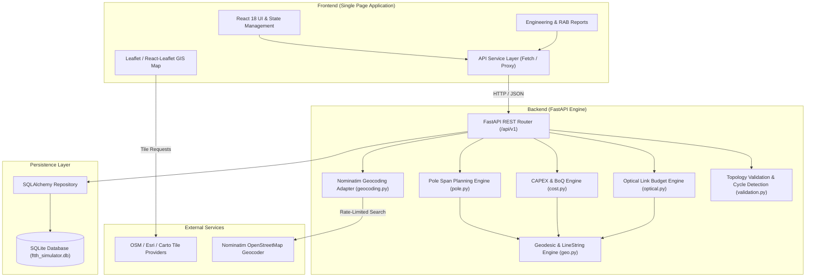

# FTTH Network Planning Simulator

> An interactive FTTH network planning and optical link budget simulation platform.

[](https://www.python.org/)
[](https://fastapi.tiangolo.com/)
[](https://react.dev/)
[](https://www.typescriptlang.org/)
[](https://vitejs.dev/)
[](LICENSE)

---

## Overview

**FTTH Network Planning Simulator** is a full-stack engineering application designed for planning, designing, and validating Fiber-to-the-Home (FTTH) access networks based on Gigabit Passive Optical Network (GPON) architectures.

Access network planning typically forces engineers to choose between generic GIS tools—which lack optical physics and telecommunication hierarchy rules—and manual calculation spreadsheets—which lack spatial route awareness, cable length accuracy, and automated topology validation. FTTH Network Planning Simulator bridges this gap by combining an interactive GIS mapping interface with a deterministic Python-based optical calculation and structural validation engine.

### Target Audience & Use Cases
* **Outside Plant (OSP) & Access Network Planners:** Layout optical distribution networks, digitize cable paths along road rights-of-way, place distribution cabinets and poles, and analyze link budgets before field survey deployment.
* **Telecommunications Students & Researchers:** Study passive optical network topologies, calculate split ratios (1:N), inspect intermediate node power levels, and understand receiver margins.
* **Software Engineers & Network Evaluators:** Explore a real-world software architecture that enforces telecommunications domain rules, validates acyclic network graphs, and computes Bill of Quantities (BoQ) estimates.

---

## Key Features

### 1. Network Planning & GIS Mapping
* **Multi-Tier GPON Node Management:** Place, configure, and inspect Optical Line Terminals (OLT), Optical Distribution Cabinets (ODC), Optical Distribution Points (ODP), Optical Network Terminals (ONT), passive optical splitters (1:2 through 1:64), utility poles, customer routers, and subscriber records.
* **Interactive Cartography:** Leaflet-based map with dual-basemap support:
  * CartoDB Positron for clean street-level vector mapping.
  * Esri World Imagery with optional boundary and place labels for aerial/satellite survey evaluation.
* **Cable Route Digitization:** Draw, split, and edit multi-segment `LineString` cable routes (Feeder, Distribution, Drop, Indoor, Custom) with vertex-level snap and drag controls.
* **Location Lookup:** Integrated Nominatim-compatible search provider with server-side caching and process-local rate limiting.
* **Coverage Area Delineation:** Define and inspect polygon boundaries for project clusters and service coverage areas.

### 2. Optical Engineering & Link Budget Simulation
* **Deterministic Path Tracing:** End-to-end directed path evaluation from root OLT ports through primary and secondary splitters down to each individual subscriber ONT.
* **Segment Fiber Attenuation:** Continuous distance-based loss calculation (\(\alpha \times L\)) using configurable attenuation coefficients (default \(0.35\text{ dB/km}\) at 1310 nm / 1490 nm).
* **Splitter Insertion Loss:** Configurable insertion loss per split ratio alongside theoretical physical split loss (\(10 \log_{10} N\)) for comparison.
* **Connector & Splice Modeling:** Discrete insertion loss accounting for mated connector pairs and fusion splices.
* **Power & Margin Calculation:** Computes received optical power (\(P_{rx} = P_{tx} - L_{total}\)), sensitivity margin (\(P_{rx} - P_{\text{sensitivity}}\)), receiver overload headroom (\(P_{\text{overload}} - P_{rx}\)), and design safety reserve margin.
* **Compliance Statusing:** Automated evaluation returning `PASS`, `FAIL`, or `UNKNOWN` with full parameter provenance tracking (`configured`, `profile_default`, `legacy_fallback`, `unknown`).
* **Intermediate Node Telemetry:** Reports calculated optical power and cumulative loss breakdowns at upstream ODC and ODP distribution points.

### 3. Structural & GPON Topology Validation
* **Hierarchical Rules Enforcement:** Enforces valid GPON tree transitions (`OLT -> ODC -> ODP -> ONT`) and prevents invalid links (e.g., upstream feeds into OLTs, optical outputs from ONTs, or optical feeds to routers).
* **Cycle Detection:** Depth-First Search (DFS) graph analysis detects and rejects prohibited topological loops and self-connections.
* **Capacity & Port Accounting:** Verifies splitter port limits, cabinet fanout capacities, OLT PON capacity, and subscriber-to-port bindings.
* **Drop Distance & Span Limits:** Flags aerial pole spans exceeding configurable maximum spans (e.g., 50 m standard, 300 m hard limit) and ODP-to-premise drop lengths exceeding 300 m.
* **Customer Premises Router Validation:** Standalone and project-node validation of IPv4 address configurations, subnet masks, and default gateways.

### 4. Bill of Quantities (BoQ / RAB) & Pole Span Planning
* **Formal Cost Estimation (RAB):** Computes a detailed Bill of Quantities separating material and labor/installation costs across cables, active/passive devices, and civil infrastructure.
* **Billed Cable Length Accounting:** Automatically factors in cable slack (default +10%) for procurement and installation estimation.
* **Subscriber Metric Analytics:** Reports total CAPEX, material subtotal, installation subtotal, and unit cost per connected customer.
* **Pole Span Analysis:** Evaluates explicit pole-to-pole spans, flags over-length aerial spans, and estimates required intermediate pole additions (`ceil(spanLength / maxSpan) - 1`).

---

## Application Workspace Views

The application provides a unified single-page interface with focused operational panels:

1. **Geographic Network Canvas:** The central map viewport for interactive node placement, route digitizing, vertex editing, and spatial measurement.
2. **Basemap & Search Controls:** Top bar controls for switching between standard street vector tiles and high-resolution satellite imagery, paired with a debounced location search dropdown.
3. **Node & Cable Inspector:** Contextual sidebar exposing device properties, port capacities, splitter ratios, fiber counts, deployment methods (aerial, underground, duct), and customer assignments.
4. **Optical Calculation Table & Engineering Report:** A tabbed workspace presenting per-path link budget summaries, intermediate node power tables, and formal engineering report documents with PDF-ready styling.
5. **RAB & Pole Planning Dashboard:** Dedicated reports detailing the itemized BoQ cost schedule, currency-formatted CAPEX breakdown, and pole span compliance checks.

---

## System Architecture

The simulator follows a layered architecture separating presentation, domain validation, deterministic engineering engines, and persistent storage.



### Architectural Highlights
* **Domain Model Aggregation:** The `Project` model acts as the root aggregate. Nodes, connections, cable segments, customer records, and engineering settings are persisted atomically to prevent orphaned records.
* **Decoupled Engines:** The calculation modules (`optical.py`, `cost.py`, `pole.py`) are pure domain services that operate on standard Pydantic models. They can be invoked independently via unit tests or script pipelines without running a web server.
* **In-Memory & API Modes:** The frontend includes an in-memory client adapter for standalone browser testing and seamlessly switches to the FastAPI backend when `VITE_API_BASE_URL` is configured.

---

## Technology Stack

| Layer | Component | Version / Technology | Purpose |
|---|---|---|---|
| **Frontend Framework** | React | `18.3.1` | Declarative UI component architecture |
| **Language (Frontend)** | TypeScript | `~5.6.2` | Static type safety and strict schema alignment |
| **Build Tooling** | Vite | `^8.3.6` | Fast development server and production bundler |
| **Mapping & GIS** | Leaflet & React-Leaflet | `1.9.4` / `4.2.1` | Interactive vector map and layer rendering |
| **Backend Framework** | FastAPI | `>=0.115.0` | High-performance Python async REST API |
| **ASGI Web Server** | Uvicorn | `>=0.30.0` | ASGI production server |
| **Data Validation** | Pydantic (v2) | `>=2.8.0` | Strict request/response schema modeling |
| **Database ORM** | SQLAlchemy | `>=2.0.0` | Database abstraction and aggregate persistence |
| **Database** | SQLite 3 | Embedded | Single-file persistent document-aggregate store |
| **Testing (Backend)** | Pytest & AnyIO | `>=8.0.0` | Automated backend engine and API route testing |
| **Testing (Frontend)** | Vitest & JSDOM | `^5.1.0` / `^25.0.1` | Unit and component integration testing |
| **Containerization** | Docker | Multi-stage | Alpine Node.js builder + Debian Python runtime |

---

## Repository Structure

```text
.
├── backend/
│   ├── app/
│   │   ├── api/            # FastAPI routes, schemas, and error handlers
│   │   ├── domain/         # Pydantic domain models and topology validation
│   │   ├── engine/         # Optical budget, BoQ cost, and pole span engines
│   │   ├── persistence/    # SQLAlchemy ORM models, database session, repository
│   │   ├── services/       # Geocoding service with rate limiting and caching
│   │   ├── config.py       # CORS, environment, and runtime settings
│   │   └── main.py         # FastAPI application entry point and static SPA server
│   ├── tests/              # Pytest test suite (216 tests)
│   └── requirements.txt    # Python dependencies
├── docs/                   # Engineering specifications, API contract, and operational notes
│   ├── API_CONTRACT.md     # Detailed REST API v1 specification and schema examples
│   ├── BACKEND_SPEC.md     # Architecture and data migration specifications
│   ├── OPERATIONS.md       # Production hosting, SQLite limits, and rate-limiting guidelines
│   └── PROJECT_SPEC.md     # FTTH network data model and lifecycle specification
├── reports/                # Engineering audit and route optimization markdown reports
├── src/                    # Frontend React SPA
│   ├── api/                # API client adapters (HTTP and in-memory fallback)
│   ├── domain/             # Client-side domain models, validation, and layout helpers
│   ├── state/              # Application state and event management
│   ├── ui/                 # React UI components, inspectors, panels, and modal dialogs
│   │   ├── inspectors/     # Node, cable, and customer configuration editors
│   │   └── reports/        # Engineering reports, optical tables, and RAB sheets
│   └── styles.css          # Application layout styling and formal report design
├── Dockerfile              # Production multi-stage Docker build specification
├── render.yaml             # Render Blueprint configuration for single-container deployment
├── package.json            # Node.js dependencies and frontend scripts
└── README.md               # Repository documentation
```

---

## Installation & Setup

### Prerequisites
* **Node.js:** `v18.0.0` or higher (`v20+` or `v22+` recommended)
* **Python:** `3.12` or `3.14`
* **Git:** Latest version

### 1. Clone the Repository
```bash
git clone https://github.com/<your-username>/ftth-network-planning-simulator.git
cd ftth-network-planning-simulator
```

### 2. Frontend Dependencies Setup
Install Node.js dependencies:
```bash
npm install
```

### 3. Backend Environment Setup
Create and activate a Python virtual environment:

**Linux / macOS:**
```bash
python3 -m venv .venv
source .venv/bin/activate
pip install --upgrade pip
pip install -r backend/requirements.txt
```

**Windows (PowerShell):**
```powershell
python -m venv .venv
.venv\Scripts\Activate.ps1
pip install --upgrade pip
pip install -r backend/requirements.txt
```

### 4. Configure Environment Variables
Copy the sample environment file to create `.env.local`:
```bash
cp .env.example .env.local
```

Ensure `.env.local` contains:
```dotenv
VITE_API_BASE_URL=/api/v1
FTTH_ENVIRONMENT=development
FTTH_DATABASE_URL=sqlite:///./ftth_simulator.db
VITE_EARTH_TILE_PROVIDER=esri_world_imagery
```

---

## Running the Application

### Option A: Local Development (Recommended)

Run backend and frontend concurrently in two separate terminals.

**Terminal 1 — Backend API:**
```bash
source .venv/bin/activate
python -m uvicorn backend.app.main:app --reload --host 127.0.0.1 --port 8000
```
* Backend API root: `http://127.0.0.1:8000`
* Interactive API Docs (Swagger): `http://127.0.0.1:8000/docs`
* Health check: `http://127.0.0.1:8000/health`

**Terminal 2 — Frontend Dev Server:**
```bash
npm run dev
```
* Vite will output the local development address, typically: `http://localhost:5173`
* Vite automatically proxies requests from `/api/v1` to `http://127.0.0.1:8000`.

---

### Option B: Single-Container Docker Execution

The multi-stage [`Dockerfile`](Dockerfile) compiles the React frontend and serves both the static SPA and the FastAPI REST API from a single container:

```bash
# Build the Docker image
docker build -t ftth-simulator:latest .

# Run the container
docker run --rm -p 10000:10000 -e PORT=10000 ftth-simulator:latest
```

Access the application in your browser:
* **Web Application:** `http://localhost:10000/`
* **API Documentation:** `http://localhost:10000/docs`
* **Health Check:** `http://localhost:10000/health`

---

## Engineering Calculation Methodology

The optical power budget engine in `backend/app/engine/optical.py` performs path traversal and calculates power levels according to ITU-T G.652, G.657, and G.671 transmission standards.

### Optical Link Budget Equations

#### 1. Total End-to-End Optical Loss
\[
L_{\text{total}} = L_{\text{fiber}} + L_{\text{splitter}} + L_{\text{connector}} + L_{\text{splice}} + L_{\text{components}}
\]

Where:
* **Fiber Attenuation (\(L_{\text{fiber}}\)):**
  \[
  L_{\text{fiber}} = \sum_{i=1}^{k} \text{round}\left(\frac{L_{i,\text{meters}}}{1000} \times \alpha_i, 2\right)
  \]
  By default, \(\alpha = 0.35\text{ dB/km}\) (standard single-mode fiber at 1310/1490 nm).
* **Splitter Insertion Loss (\(L_{\text{splitter}}\)):** Configured insertion loss for cascaded passive optical splitters. The engine also compares this against the theoretical physical split loss:
  \[
  L_{\text{ideal}} = 10 \log_{10}(N) \quad [\text{dB}]
  \]
  *(e.g., \(9.03\text{ dB}\) for a 1:8 splitter, with typical real-world insertion loss rated at \(10.0 - 10.5\text{ dB}\)).*
* **Connector Pair Loss (\(L_{\text{connector}}\)):** Discrete loss per mated connector pair (default \(0.25 - 0.50\text{ dB}\) per pair).
* **Fusion Splice Loss (\(L_{\text{splice}}\)):** Discrete loss per fusion joint (default \(0.10\text{ dB}\) per splice).

#### 2. Received Optical Power
\[
P_{rx} = P_{tx} - L_{\text{total}}
\]
Where \(P_{tx}\) is the OLT optical transmitter launch power (typically \(+2.5\text{ dBm}\) to \(+7.0\text{ dBm}\) for Class B+/C+ optics).

#### 3. Optical Headroom Margins
* **Receiver Sensitivity Margin:** Headroom above the minimum detection threshold before bit-error-rate (BER) degradation:
  \[
  M_{\text{sensitivity}} = P_{rx} - P_{\text{sensitivity}}
  \]
* **Receiver Overload Margin:** Protection margin preventing photodiode saturation or optical damage:
  \[
  M_{\text{overload}} = P_{\text{overload}} - P_{rx}
  \]
* **Net Design Margin:** Operational margin accounting for safety and fiber aging reserves:
  \[
  M_{\text{design}} = P_{rx} - P_{\text{sensitivity}} - M_{\text{safety}}
  \]

### Compliance Status Definitions
* **`PASS`:** \(P_{\text{sensitivity}} \le P_{rx} \le P_{\text{overload}}\) and \(M_{\text{design}} \ge 0\).
* **`FAIL`:** Either \(P_{rx} < P_{\text{sensitivity}}\) (optical signal too weak) or \(P_{rx} > P_{\text{overload}}\) (receiver saturated).
* **`UNKNOWN`:** Missing input parameters, disconnected paths, or unverified legacy fallback provenance without explicit user confirmation.

---

## API Documentation

The backend exposes a fully typed REST API versioned under `/api/v1`. Interactive OpenAPI documentation is accessible at `/docs` (Swagger UI) and `/redoc`.

| HTTP Method | Endpoint | Description |
|---|---|---|
| `GET` | `/health` | Root system health check |
| `GET` | `/api/v1/health` | API v1 status and version confirmation |
| `GET` | `/api/v1/projects` | List all saved projects with device summary counts |
| `POST` | `/api/v1/projects` | Create a new project aggregate (server generates UUID if omitted) |
| `GET` | `/api/v1/projects/{projectId}` | Load complete project aggregate by ID |
| `PUT` | `/api/v1/projects/{projectId}` | Create or replace project data idempotently |
| `DELETE` | `/api/v1/projects/{projectId}` | Delete project aggregate |
| `POST` | `/api/v1/projects/{projectId}/calculations/optical-budget` | Compute end-to-end optical link budget and intermediate node power |
| `POST` | `/api/v1/projects/{projectId}/calculations/construction-cost` | Generate formal Bill of Quantities (BoQ / RAB) CAPEX schedule |
| `POST` | `/api/v1/projects/{projectId}/calculations/pole-spans` | Calculate aerial pole spans and estimate additional pole requirements |
| `POST` | `/api/v1/projects/{projectId}/validate-connection` | Pre-validate candidate connection against GPON topology rules |
| `GET`, `POST`| `/api/v1/projects/{projectId}/validate-topology` | Perform comprehensive structural and capacity validation |
| `POST` | `/api/v1/validate-router-config` | Validate standalone customer router IP configuration |
| `POST` | `/api/v1/projects/{projectId}/nodes/{nodeId}/validate-router` | Validate router configuration for a specific project node |
| `GET` | `/api/v1/geocoding/search` | Search geographical locations via rate-limited Nominatim adapter |

See [docs/API_CONTRACT.md](docs/API_CONTRACT.md) for full request/response schemas and JSON payloads.

---

## Testing & Quality Assurance

The codebase includes comprehensive unit, integration, and type-checking suites across both frontend and backend.

### Running Backend Tests (Pytest)
```bash
source .venv/bin/activate
pytest -q
```
* **Coverage:** 216 tests covering optical budget mathematics, topology validation, cycle detection, BoQ cost estimation, pole span algorithms, and REST routes.

### Running Frontend Tests (Vitest)
```bash
npm test
```
* **Coverage:** 37 test suites and 219 tests verifying React components, map interaction, inspector dialogs, report tables, and client validation rules.

### TypeScript Type Checking
```bash
npx tsc -b
```
* Validates static type safety across client domain types, component props, and API contract interfaces.

### Production Build Verification
```bash
npm run build
```
* Executes TypeScript build check and bundles optimized frontend distribution assets into `dist/`.

---

## Deployment Configuration

### Single-Container Deployment
The repository includes a ready-to-deploy [`Dockerfile`](Dockerfile) designed for cloud platforms supporting container runtimes (such as Google Cloud Run, AWS App Runner, or Render Web Services).

* **Architecture:** Multi-stage build (Node.js 22 alpine builds static assets; Python 3.12-slim runs Uvicorn).
* **Port Binding:** Binds to `0.0.0.0:${PORT:-10000}`.
* **Static Assets:** FastAPI directly serves compiled client assets from `/app/dist` for non-API routes.

### Render Blueprint
A [`render.yaml`](render.yaml) specification is provided for one-click deployment to Render Web Services.

> [!WARNING]
> **Ephemeral Storage Limitation on Free Tiers:**
> Free cloud container tiers (such as Render Free) use an ephemeral container filesystem. While SQLite (`ftth_simulator.db`) functions normally during container execution, **any created or updated project data will be lost when the container spins down due to inactivity or restarts**. For permanent production deployments, use a persistent disk volume or migrate the SQLAlchemy storage adapter to a managed database (e.g., PostgreSQL).

---

## Engineering Limitations & Assumptions

Transparent engineering assumptions governing current simulation calculations:

1. **Simulation vs Physical Measurement:** Optical budget calculations are deterministic mathematical simulations based on user-configured equipment values and theoretical attenuation coefficients. They do not replace physical field measurements using Optical Time-Domain Reflectometers (OTDR) or Optical Power Meters (OPM).
2. **Desktop Routing vs Physical Outside Plant (OSP):** Cable routes drawn on the map follow road centerlines or user vertices. Physical outside plant installation may require additional slack, directional boring, bridge crossings, or building conduit entries that cannot be detected purely from satellite imagery.
3. **Aerial Pole Attachment Feasibility:** Algorithmic pole placement estimates (`ceil(span / maxSpan) - 1`) are planning approximations. Physical pole installation requires structural load analysis, pole height clearance verification, and local utility make-ready agreements.
4. **Concurrency & Database Throughput:** The backend persistence layer currently uses SQLite with serialized writes (`workers = 1`). It is designed for single-planner or small-team design sessions. High-concurrency enterprise use requires a PostgreSQL backend.
5. **Geocoding Rate Limiting:** The default Nominatim integration uses public OpenStreetMap infrastructure with a process-local 1.1-second rate limit. High-volume commercial deployments must configure a dedicated geocoding service.

---

## Roadmap

Planned enhancements for future releases:

- [ ] **Data Export Formats:** Export network assets to GIS-standard formats (GeoJSON, ESRI Shapefile, and Google Earth KML/KMZ).
- [ ] **Multi-User Collaboration:** User authentication, role-based access control (RBAC), and project revision locking.
- [ ] **PostgreSQL / PostGIS Adapter:** Optional database driver configuration for spatial indexing and concurrent multi-tenant storage.
- [ ] **OTDR Trace Ingestion:** Import `.sor` Bellcore/Telcordia trace files to compare simulated link loss directly against real-world field measurements.
- [ ] **Automated Road Snap Routing:** Optional integration with routing engines (OSRM / GraphHopper) to automatically snap cable polylines along road centerlines.

---

## Contribution & License

### Contributing
Contributions to the FTTH Network Planning Simulator are welcome. To contribute:
1. Fork the repository.
2. Create a feature branch: `git checkout -b feature/optical-enhancement`.
3. Ensure all tests pass: `pytest` and `npm test`.
4. Ensure TypeScript type check passes: `npx tsc -b`.
5. Submit a descriptive Pull Request.

### License
This project is licensed under the **GNU General Public License v3.0 (GPL-3.0)**. See the [LICENSE](LICENSE) file for the complete license terms.
